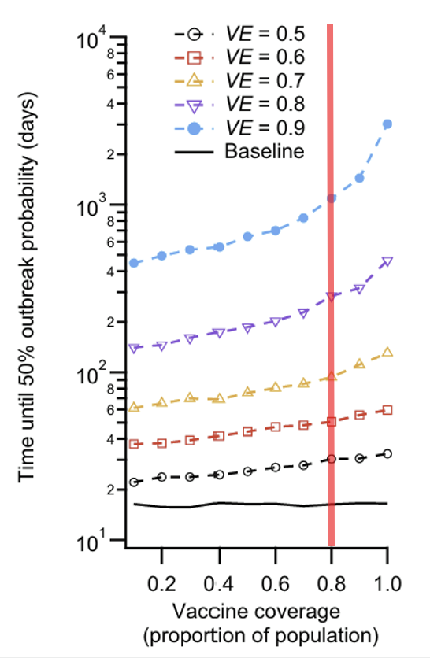

::: {.lede}
**When is international travel actually safe again?**    
Hotel quarantine has protected Australia for most of the pandemic, but fast‑spreading COVID‑19 variants have shown that even small leaks can grow quickly once they reach the community. As borders reopen, the key issue becomes whether vaccination can buy enough time to stop a leak from turning into a major outbreak.
:::

This post explains why quarantine alone can’t hold back highly contagious variants, and how high community vaccination levels create a “firewall” that stops border leaks from turning into outbreaks. The goal is simple: help you understand how your own vaccination contributes to safer borders, and what vaccination targets make international travel realistically possible again.

To understand when borders can reopen safely, we need to look at what actually happens when a single infected traveller slips through quarantine.

Researchers from the University of Melbourne, the Doherty Institute, and Monash University modelled thousands of “border‑leak” scenarios using real Australian and New Zealand quarantine data (@zachreson2022). Their simulations capture how quickly newer COVID variants spread, how effective vaccination is at blocking transmission, and how often quarantine leaks occur. The goal was simple: estimate the chance that a single leak grows into a community outbreak.

## Quarantine Isn’t Enough Anymore
The results are clear. When a fast‑spreading variant enters the community, hotel quarantine alone cannot reliably prevent outbreaks. Even small leaks grow quickly because each infected person passes the virus on to more people than earlier strains. In the model, a single leak often led to dozens of infections before contact tracers could intervene.

@fig-outbreak-delays shows how vaccination changes the timeline of a border leak. At low vaccination coverage, the time until a leak reaches a 50% chance of becoming an outbreak is short — often just days or weeks. As coverage increases, the curves rise sharply, showing that outbreaks take much longer to gain momentum. The red vertical line marks 80% coverage, a key threshold in the model: beyond this point, high‑efficacy vaccines slow transmission so effectively that a single leak may take months or even years to reach the same level of risk.

```{r}
#| echo: false
#| label: fig-outbreak-delays
#| fig-cap: "Modelled time until a 50% outbreak probability following a single border leak, across different levels of vaccine coverage and vaccine efficacy. Higher coverage and higher efficacy both substantially delay the point at which a leak becomes likely to grow into an outbreak. (Adapted from Figure4B of Zachreson et al. (2022))" 
#| fig-width: 8
#| fig-height: 4.8


```
::: {.finding} 
::: {.finding-title} 
What does “vaccine efficacy (VE)” mean?
::: 
Vaccine efficacy is a measure of **how well the vaccine stops the virus from spreading**.  
A VE of 0.8 means the vaccine reduces a person’s chance of catching or passing the virus on by about 80%.
Higher VE doesn’t just protect individuals — it slows transmission across the entire community, making it much harder for a border leak to spark an outbreak.
:::

## At 80% Coverage, Outbreak Risk Slows Dramatically
Vaccination dramatically reduces the chance that a border leak becomes an outbreak. When most people are vaccinated, the virus struggles to find new hosts, slowing transmission and giving contact tracers time to respond. In the model, once community vaccination reaches around 80% with high‑efficacy vaccines (vaccine efficacy ≈ 80%), the timeline for a leak to grow into an outbreak stretches out dramatically.

@tbl-outbreak-benchmarks summarises these benchmark timelines using the vaccine efficacy = 80% curve from the model. At low coverage, leaks grow quickly and outbreaks emerge within months. At moderate coverage, transmission slows but outbreaks remain likely. At high coverage (≥ 80%), the delay extends into the hundreds of days — creating a meaningful “biosecurity buffer” where most leaks fizzle out before they spread widely.

```{r}
#| echo: false
#| message: false
#| warning: false
#| label: tbl-outbreak-benchmarks
#| tbl-cap: "Benchmark outbreak timelines at different vaccination coverage levels, based on the VE = 80% scenario."
library(dplyr)
library(knitr)
library(kableExtra)

scenarios <- tibble(
  "Coverage Level" = c(
    "Low (< 50%)",
    "Moderate (60–70%)",
    "High (≥ 80%)"
  ),
  "Expected Outbreak Delay" = c(
    "< 200 days",
    "200 - 300 days",
    "300 - 500 days"
  ),
  "Risk Interpretation" = c(
    "High risk — leaks grow quickly ",
    "Elevated risk — outbreaks slow but still likely",
    "Biosecurity firewall — leaks rarely grow"
  )
)

scenarios |>
  kable() |>
  kable_styling(
    full_width = FALSE,
    bootstrap_options = c("striped", "hover", "condensed"),
    font_size = 14
  ) |>
  row_spec(0, bold = TRUE, background = "#242F40", color = "white") |>   # header row
  row_spec(1, background = "#F8F9FA") |>                               # light grey
  row_spec(2, background = "#E5E5E5") |>                               # mid grey
  row_spec(3, background = "#CCA43B", color = "#242F40")                  # gold 
```


## Policy Takeaway
### Community Vaccination Acts as a Biosecurity Firewall
Hotel quarantine has been an indispensable line of defence, but fast-spreading variants like Delta mean that standalone border controls are no longer enough. While quarantine reduces the *frequency* of infected arrivals entering the community, population vaccination determines *what happens next*.
For people planning international travel, these results explain why border reopening depends on widespread community vaccination rather than quarantine rules alone.

Without high community immunity, even a single border leak can spark a rapid local outbreak. But when 80% of the community is vaccinated, viral transmission stalls—turning a potentially dangerous leak into a manageable event.

::: {.takeaway-card}
### Summary for Travelers & Communities   
Quarantine limits how often leaks happen. High vaccination coverage — especially around 80% — determines whether those leaks grow. With strong community immunity, most leaks fizzle out, making reopening far safer.
:::

